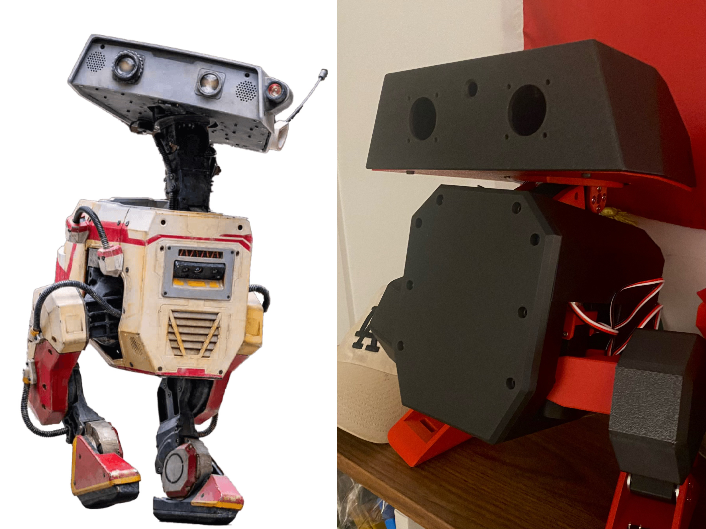

<!-- Project BD-X_Servant -->
  

  <!-- Left Box - Text Content -->
    <a href="./BD-X_Servant" style="
      text-decoration: none;
      color: inherit;
      width: 50%;
      padding: 10px;
      display: flex;
      flex-direction: column;
      position: relative;
      z-index: 2;
    ">
    
      

        <h2 style="margin: 0; padding-top: 10px; padding-left:10px">
          BD-X Servant
        </h2>
        

          <i>Aug 2026 - </i>
        

        <h5 style="padding: 0 10px; padding-top: 15px; margin: 0">
          A RL trained bipedal robot servant inspired by BD-X. 
          
          <!-- Performs navigation soley using external sensor inputs and runs room cleaning tasks with a separately fine-tuned VLA policy. -->
        </h5>
        

      
          

            <h6 style="margin: 0">In Progress</h6>
          

        

          
      

    </a>

  <!-- Right Box - Image -->
      

      
    

  

  