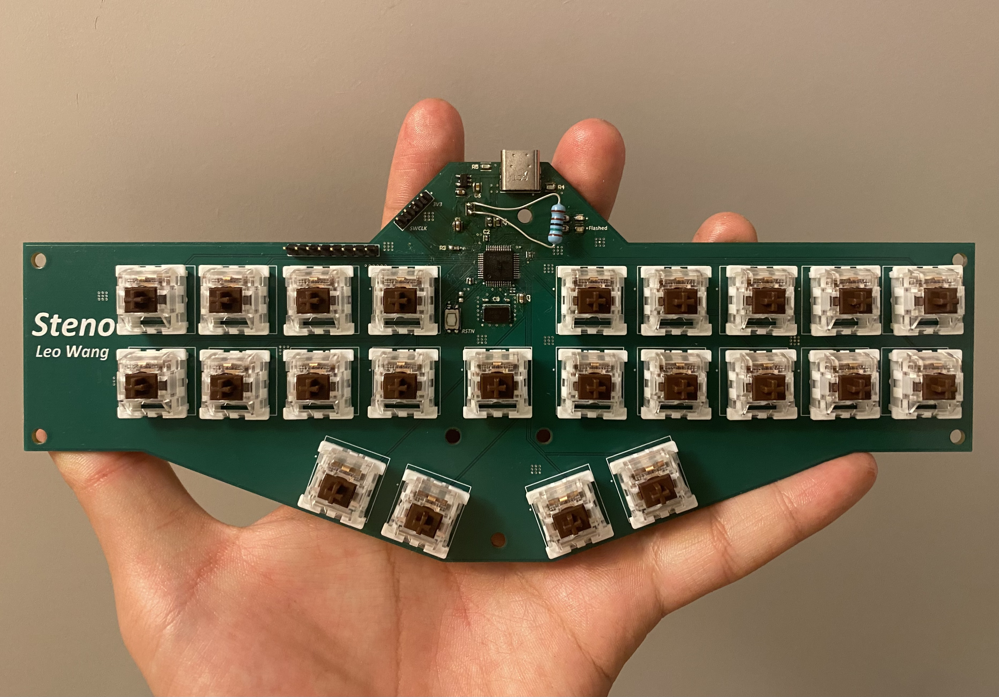

## Stenokeyboard
*Oct 2025 - Dec 2025*

    
    

    <figure style="margin: 0;">
        
        <figcaption style="margin-top: 8px; color: #666;">Figure 1: Assembled PCB</figcaption>
    </figure>

A stenokeyboard is a keyboard that forms words based on key combinations that mimic pronunciation which enables faster typing. It has been popular for decades among court reporters.

<figure style="margin: 0;">
<video style="border-radius: 10px; width: 340px" controls>
<source src="/assets/img/Steno/StenoWorking.mp4" type="video/mp4">
        Your browser does not support the video tag.
</video>
<figcaption style="margin-top: 8px; color: #666;">Figure 2: Working demo</figcaption>
</figure>

<h3 style="margin-bottom:10px; margin-top:10px">Design & Debugging</h3>
I designed the PCB, soldered the 0402 components, coded the firmware in C, and tested the system myself. A few mistakes and interesting considerations came up along the way.

For the PCB layout, each GPIO is mapped to a key switch, so I cross-referenced pin locations to keep routing short and clean. During assembly, incorrect load capacitance values on the external crystal driving the USB peripheral caused communication issues with the host computer. I debugged it with an oscilloscope and GPIO toggling tests to rule out a chip failure.

<!-- The chip STM32F103 includes more than 23 GPIO pins which is enough to connect each switch and so I decided not to use a more complex design with keyboard matrix.

The original approach was to use hardware interrupt lines to detect key presses and record them within a defined time period. However, there was not enough interrupt lines. So instead, I used a loop that polls the GPIO pins and monitors key state changes in software.

This project uses Plover, an open source application that inteprates input from the keyboard. Plover uses the TX Bolt protocol over serial. Each word consists of 4 bytes of data with each bit indicating a pressed key. -->

 <!-- <a href="https://develop-docs.qmk.fm/features/stenography">
Link to the protocol
     -->

[Back](./AESN.html)